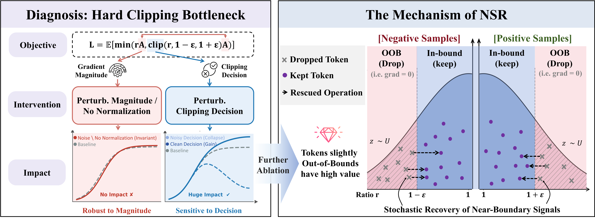
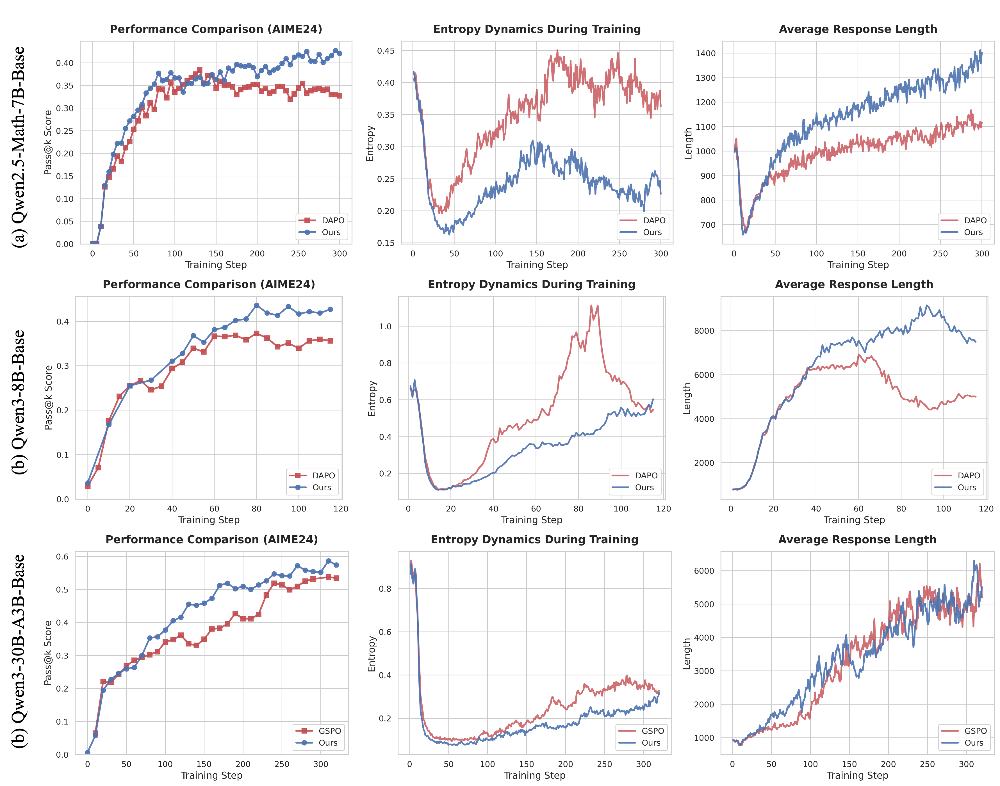
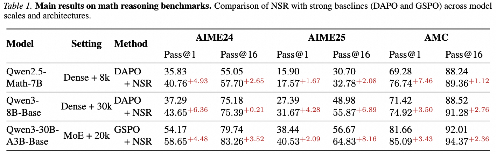
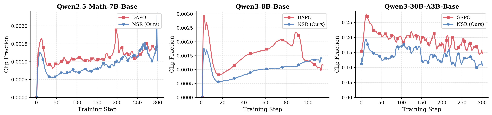

# Clipping Bottleneck: Stabilizing RLVR via Stochastic Recovery of Near-Boundary Signals

## Introduction



*Figure 1. Overview of diagnosis and the NSR solution. Left (Diagnosis): controlled interventions reveal that training is robust to gradient magnitude but hypersensitive to the binary clipping decision, identifying rigid boundary discarding as the bottleneck. Right (Mechanism): NSR stochastically rescues near-boundary out-of-bound updates and recovers useful signals.*


Reinforcement Learning with Verifiable Rewards (RLVR), including GRPO/DAPO-style objectives, often suffers from instability and entropy collapse during training.

This repo presents **NSR (Near-boundary Stochastic Rescue)**, a minimal plug-and-play modification to PPO-style clipping:


- Standard hard clipping uses a rigid binary decision and may discard valuable updates just outside the trust region.
- NSR gives those near-boundary updates a stochastic chance to be rescued back into optimization.
- In our experiments, this improves training stability and brings consistent gains on math reasoning benchmarks (e.g., AIME24), across model scales from 7B dense to 30B MoE.

---

## Core Change

The key idea is to keep the original clipping rule, but add a stochastic rescue path for out-of-bound ratios.

### Pseudocode

```python
def nsr_policy_loss(r_dec, A, eps_low, eps_high, delta):
    # Trust region I(A)
    if A > 0:
        I = (-inf, 1 + eps_high]
    else:
        I = [1 - eps_low, +inf)

    # Case 1: original ratio already admissible
    if r_dec in I:
        r_tilde = r_dec
    else:
        z = sample_uniform(1 - delta, 1 + delta)
        r_exec = r_dec * z

        # Case 2: rescued back into trust region
        if r_exec in I:
            r_tilde = r_exec
        # Case 3: still out-of-bound, use hard clipping
        else:
            r_tilde = clip(r_dec, I)

    return clipped_policy_loss(r_tilde, A)
```

### Where to modify in VeRL

For DAPO/token-level training, the practical change is localized in:

- `verl/trainer/ppo/core_algos.py` (the NSR block around `compute_policy_loss`, at the section corresponding to line range 704-724 in this repo snapshot)

That block applies:

1. boundary masks from `(ratio, advantage sign)`,
2. random multiplicative factor in `[1 - nsr_delta, 1 + nsr_delta]`,
3. detached scaling to form `ratio_final = ratio * scale_factor.detach()`.

---

## GSPO Adaptation (Sequence-level Ratio)

For GSPO, keep the same NSR idea, but apply it on **sequence-level importance ratio** instead of token-level ratio.

In practice, we use a much tighter perturbation for GSPO:

- `NSR=True`
- `nsr_delta = 0.001` (i.e., random scale in `[0.999, 1.001]`)

Below is a cleaned example aligned with the style of `compute_policy_loss`:

```python
@register_policy_loss("gspo")
def compute_policy_loss_gspo(
    old_log_prob: torch.Tensor,
    log_prob: torch.Tensor,
    advantages: torch.Tensor,
    response_mask: torch.Tensor,
    loss_agg_mode: str = "seq-mean-token-mean",
    config: Optional[ActorConfig] = None,
    rollout_is_weights: torch.Tensor | None = None,
    NSR: bool = False,
) -> tuple[torch.Tensor, dict[str, Any]]:
    """
    Compute GSPO policy loss with optional NSR on sequence-level importance ratio.
    """
    assert config is not None
    assert isinstance(config, ActorConfig)
    clip_ratio_low = config.clip_ratio_low if config.clip_ratio_low is not None else config.clip_ratio
    clip_ratio_high = config.clip_ratio_high if config.clip_ratio_high is not None else config.clip_ratio

    # GSPO uses sequence-level KL / ratio
    negative_approx_kl = log_prob - old_log_prob
    seq_lengths = torch.sum(response_mask, dim=-1).clamp(min=1)
    negative_approx_kl_seq = torch.sum(negative_approx_kl * response_mask, dim=-1) / seq_lengths

    log_seq_ratio = log_prob - log_prob.detach() + negative_approx_kl_seq.detach().unsqueeze(-1)
    log_seq_ratio = torch.clamp(log_seq_ratio, max=10.0)
    seq_ratio = torch.exp(log_seq_ratio)
    ppo_kl = verl_F.masked_mean(-negative_approx_kl, response_mask)

    ratio_final = seq_ratio

    # Optional NSR for GSPO (tight perturbation window by default)
    if hasattr(config, "policy_loss"):
        NSR = config.policy_loss.get("NSR", NSR)
        nsr_delta = config.policy_loss.get("nsr_delta", 0.001)
    else:
        nsr_delta = 0.001

    if NSR:
        limit_upper = 1.0 + clip_ratio_high
        limit_lower = 1.0 - clip_ratio_low

        mask_high = (seq_ratio > limit_upper) & (advantages > 0)
        mask_low = (seq_ratio < limit_lower) & (advantages < 0)

        scale_factor = torch.ones_like(seq_ratio)
        low_bound = 1.0 - nsr_delta
        high_bound = 1.0 + nsr_delta
        rand_high = torch.empty_like(seq_ratio).uniform_(low_bound, high_bound)
        rand_low = torch.empty_like(seq_ratio).uniform_(low_bound, high_bound)

        scale_factor = torch.where(mask_high, rand_high, scale_factor)
        scale_factor = torch.where(mask_low, rand_low, scale_factor)

        ratio_final = seq_ratio * scale_factor.detach()

    pg_losses1 = -advantages * ratio_final
    pg_losses2 = -advantages * torch.clamp(ratio_final, 1.0 - clip_ratio_low, 1.0 + clip_ratio_high)
    pg_losses = torch.maximum(pg_losses1, pg_losses2)

    if rollout_is_weights is not None:
        pg_losses = pg_losses * rollout_is_weights

    pg_loss = agg_loss(
        loss_mat=pg_losses,
        loss_mask=response_mask,
        loss_agg_mode=loss_agg_mode,
        **config.global_batch_info,
    )

    pg_clipfrac = verl_F.masked_mean(torch.gt(pg_losses2, pg_losses1).float(), response_mask)
    pg_clipfrac_lower = torch.tensor(0.0, device=pg_loss.device)
    pg_metrics = {
        "actor/pg_clipfrac": pg_clipfrac.detach().item(),
        "actor/ppo_kl": ppo_kl.detach().item(),
        "actor/pg_clipfrac_lower": pg_clipfrac_lower.detach().item(),
    }
    return pg_loss, pg_metrics
```

---

## ✨ Getting Started

We inherit environment setup and quick start from VERL. Please follow the official docs:

- Install: <https://verl.readthedocs.io/en/latest/start/install.html>
- Quick Start: <https://verl.readthedocs.io/en/latest/start/quickstart.html>

This repo only changes the DAPO recipe by adding a single switch to enable NSR in policy loss (plus optional `nsr_delta` tuning):

- `actor_rollout_ref.actor.NSR=True`
- (optional) `actor_rollout_ref.actor.nsr_delta=0.1`

Original DAPO scripts for reference:

- <https://github.com/volcengine/verl/tree/main/recipe/dapo>

---

## ⚙️ Training

### Backend setup by model scale

- **7B / 8B**: trained with **FSDP**
- **30B MoE**: trained with **Megatron**

### Ready-to-run scripts

We provide two ready-to-run scripts (repo paths):

- `recipe/nsr/NSR_delta_0.1_7b.sh`
- `recipe/nsr/NSR_delta_0.1_8b.sh`

Example:

```bash
bash recipe/nsr/NSR_delta_0.1_7b.sh
```

### What changed in the scripts?

Compared with baseline DAPO launchers, the NSR scripts only add NSR-related flags, e.g.:

```bash
actor_rollout_ref.actor.NSR=True \
actor_rollout_ref.actor.nsr_delta=0.1
```

Other training pipeline components remain aligned with standard VeRL/DAPO setup.

---

## 📊 Results & Figures

Main empirical takeaway: NSR consistently improves stability and yields around **+5%** gains on AIME24 in our runs.



*Training dynamics. NSR converges to better validation performance, maintains healthier policy entropy, and encourages longer responses, consistent with improved utilization of near-boundary learning signals.*



*Main benchmark results across model scales and backbones (7B dense to 30B MoE). NSR consistently improves average pass@k style reasoning metrics over baseline DAPO/GSPO settings.*



*Clip-fraction analysis. NSR consistently lowers the fraction of clipped updates throughout training, indicating better sample utilization in both token-level and sequence-level objectives.*

---

## 🎈 Citation

If you find this work useful, please cite:

```bibtex
@misc{yang2026clipping,
  title = {Clipping Bottleneck: Stabilizing RLVR via Stochastic Recovery of Near-Boundary Signals},
  url = {https://qwen-pilot.notion.site/xxx},
  author = {Yang, Shuo and Lu, Jinda and Ma, Chiyu and Huang, Kexin and Meng, Haoming and Zhang, Qihui and Liu, Yuyang and Ding, Bolin and Wang, Guoyin and Yuan, Li and Zhou, Jingren},
  year = {2026},
  month = {xxx},
}
```

---

## 🌻 Acknowledgement

We build on **VeRL** and standard math-reasoning evaluation protocols.

VeRL repository: <https://github.com/verl-project/verl>
